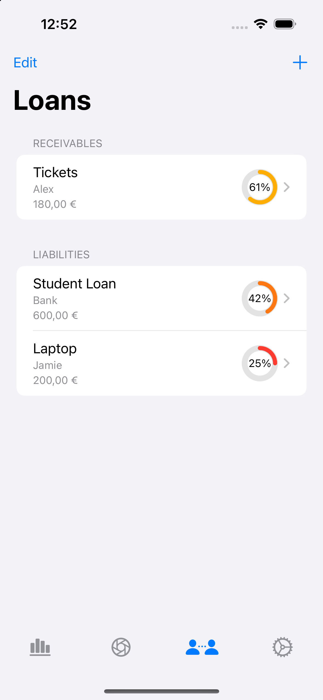
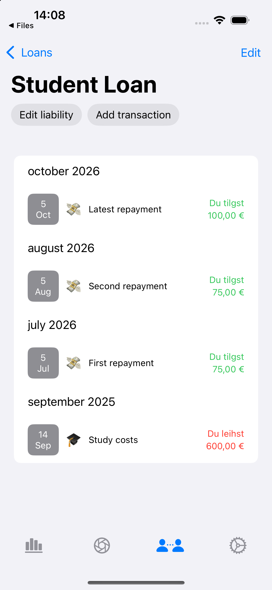
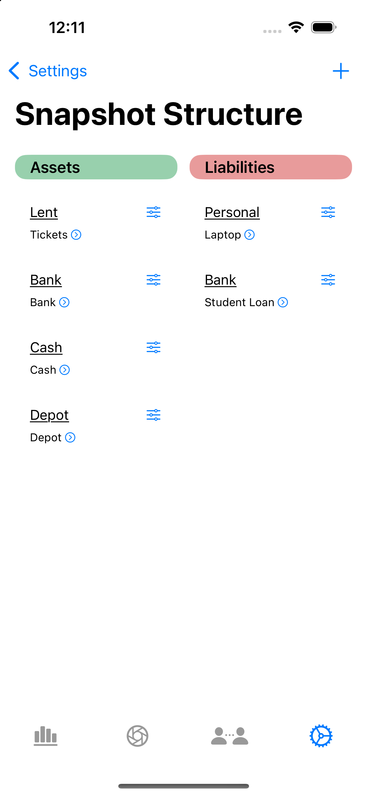
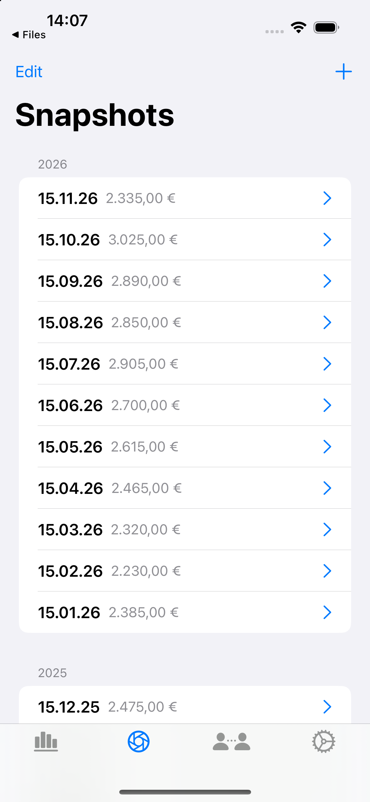
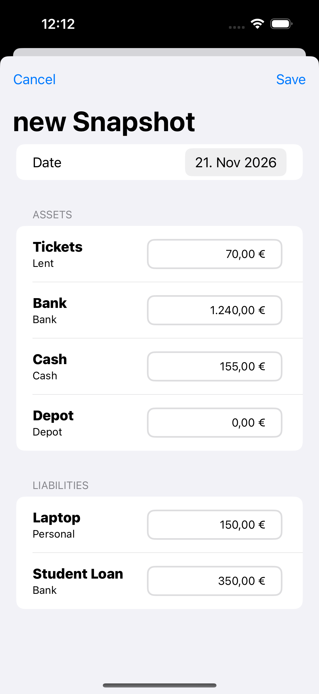
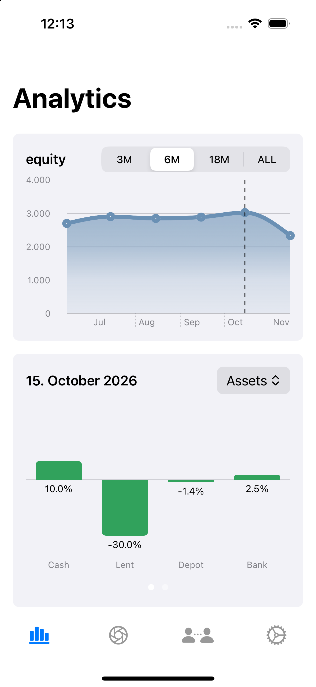
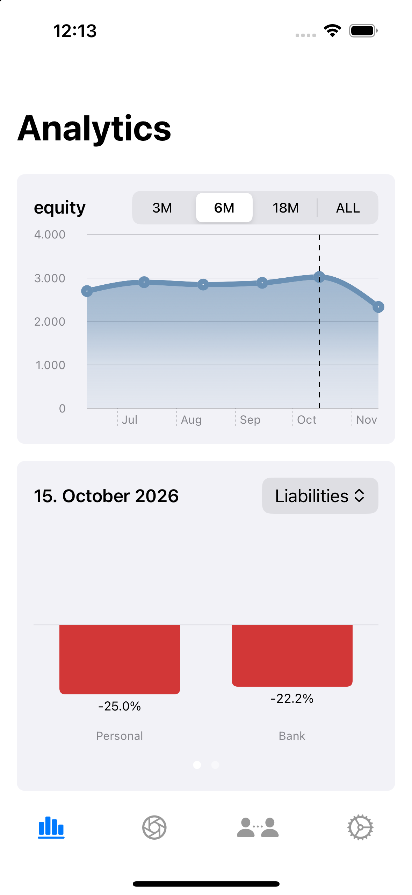
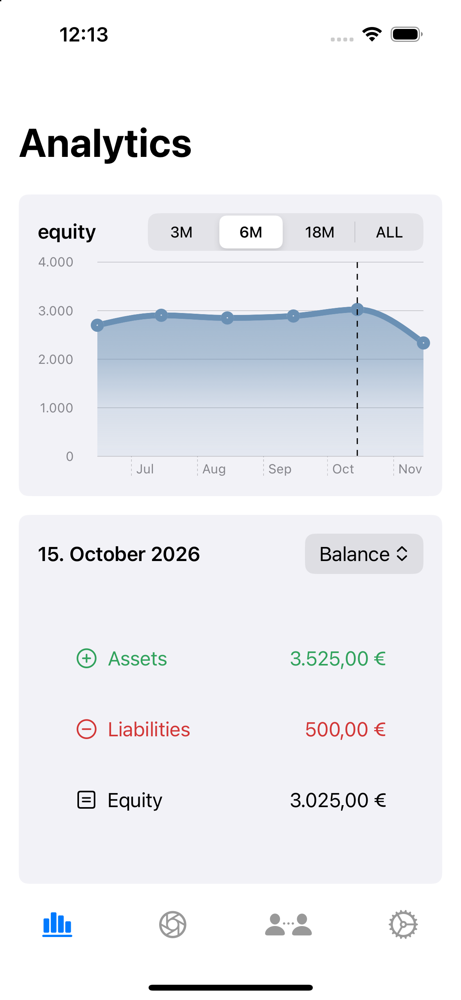

# EquityLab

## Purpose

I built EquityLab to track my finances with a focus on equity, rather than the cash flows most finance apps emphasize. The idea is to keep a precise record of all assets and liabilities and see what actually remains after subtracting what I owe from what I own. Taking snapshots over time makes it possible to observe how that net worth develops.

## Features

### Track Loans

Track money you borrow and lend, including the people or institutions involved. Record transactions and repayments, review their history, and see how much of each loan has been repaid.

<p>
  
  
</p>

### Define Snapshot Structure

Define the assets and liabilities you want to track and organize them into pools such as bank accounts, investments, or personal loans. Edit the structure as your financial situation changes.



### Take Snapshots

Capture your financial position on a chosen date by entering the value of each asset and liability. Browse previous snapshots and revisit the values behind your equity at each point in time.

<p>
  
  
</p>

### Visualize Snapshots

Follow your equity over time and select a snapshot to explore its details. Review changes and distributions across asset and liability pools, or see the balance of assets, liabilities, and equity.

<p>
  
  
  
</p>

## Local Setup

The app was built before Liquid Glass, and I haven't had time to update the UI for it. Run it in an **iOS 18 simulator** to see the interface as originally designed.

### App

Required installations:

- Xcode with iOS 18 simulator support
- An iOS 18 simulator runtime, installed through Xcode's Settings

From the repository root, open the project:

```sh
open EquityLab.xcodeproj
```

Let Xcode resolve the Swift Package dependencies, select the **EquityLab** scheme and an **iPhone simulator running iOS 18**, then press **⌘R** to build and run the app.
